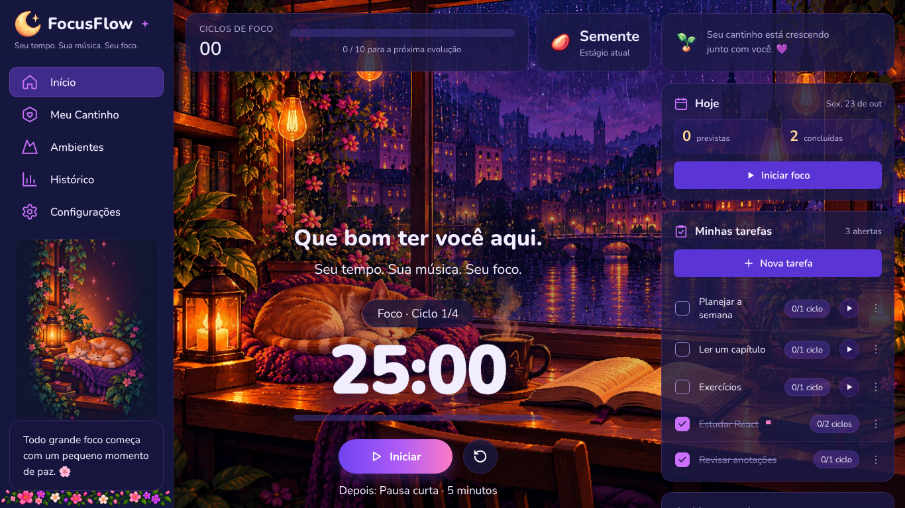
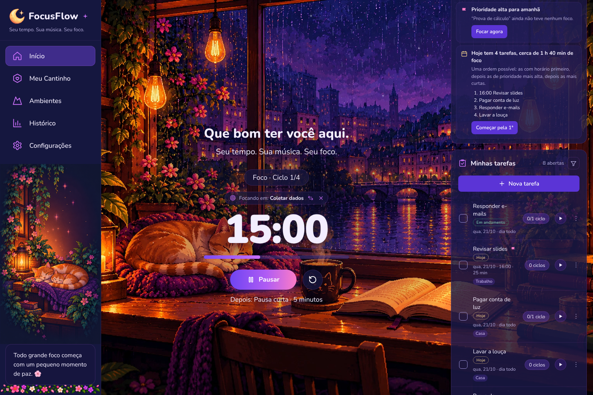
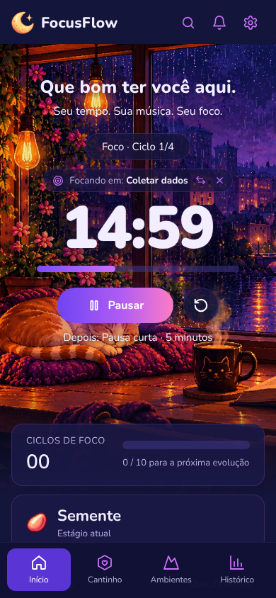
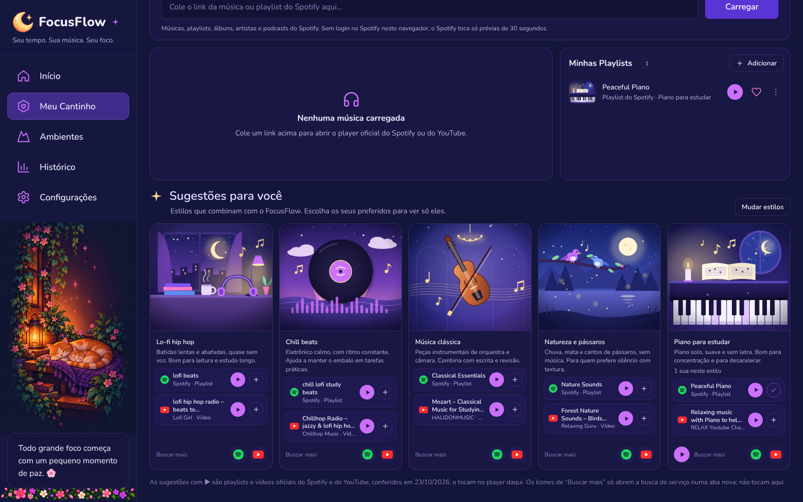
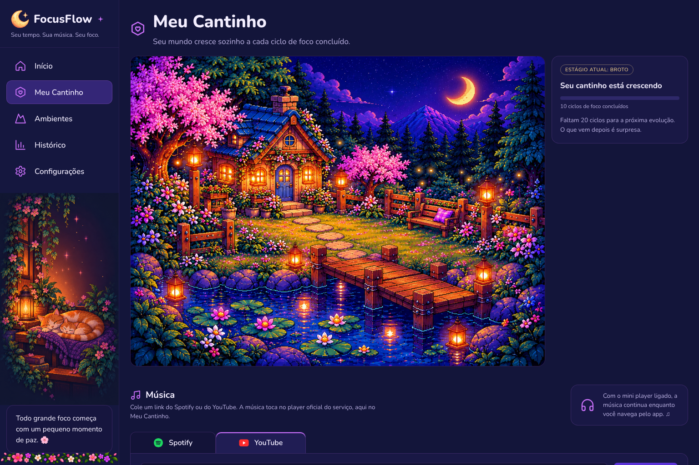

<div align="center">



<sub>Tela inicial do FocusFlow com o cenário animado Café na chuva.</sub>

# 🌙 FocusFlow

### Seu tempo. Sua música. Seu foco.

**Um ciclo de cada vez. Um jardim de cada vez.**

Um app de foco que combina Pomodoro, tarefas, música e cenários animados em pixel art, com a atmosfera acolhedora dos cozy games.


<sub>🧪 Versão 1.0.0 em teste fechado · ainda não aberta ao público</sub>

<sub>🎧 Atmosfera lo-fi · 🌱 Pequenas conquistas · ☕ Foco e descanso</sub>

</div>

---

## 🍃 Sobre o projeto

O **FocusFlow** é um projeto acadêmico de aplicação web para organizar momentos de concentração e descanso. A proposta é transformar sessões de estudo ou trabalho em uma experiência visual acolhedora: enquanto o cronômetro roda, você escolhe um cenário, organiza as tarefas, ouve música e vê o seu **Jardim do Flow** crescer a cada ciclo de foco concluído.

A ideia nasceu da vontade de estudar com mais estrutura e tornar o início de uma sessão mais convidativo. O projeto valoriza pequenos avanços, pausas e uma experiência inspirada em **cozy games, pixel art e lo-fi**, com um visual noturno e roxo que funciona no computador e no celular.

O FocusFlow começou como protótipo no Lovable, virou um protótipo interativo em React e, em cinco dias de trabalho em etapas pequenas, chegou à versão 1.0.0 como projeto web com contas e sincronização.

## 🖼️ O FocusFlow hoje

<div align="center">
  
  <br />
  <sub>Ciclo de foco ligado a uma tarefa, com sugestões e a lista de tarefas ao lado.</sub>
</div>

<br />

<div align="center">
  
  <br />
  <sub>A mesma experiência no celular.</sub>
</div>

## 🎯 O problema

Organizar a rotina de estudos envolve mais do que iniciar um cronômetro. Entre os desafios que motivaram o projeto estão:

- Começar e sustentar períodos de concentração.
- Lembrar de descansar entre as sessões.
- Saber em qual tarefa focar quando o dia está cheio.
- Encontrar ferramentas agradáveis e personalizáveis.
- Perceber o próprio progresso ao longo do tempo.

O FocusFlow reúne **gestão do tempo, tarefas, ambiente e motivação** em uma mesma experiência.

## ✨ A experiência FocusFlow

| Elemento | O que faz |
| --- | --- |
| ⏱️ Pomodoro | Alterna foco e pausas, com tempos ajustáveis e ligado à tarefa escolhida. |
| ✅ Tarefas | Prioridade, categoria, prazo, filtros e sugestões do que fazer primeiro. |
| 🍵 Cenários animados | Sete ambientes em vídeo para estudar ou trabalhar. |
| 🎧 Música | YouTube e Spotify tocando dentro do app, com mini player entre as páginas. |
| 🌱 Jardim do Flow | Evolui sozinho por cinco etapas conforme os ciclos de foco. |
| 📅 Calendário | Exportação das tarefas para o calendário (.ics). |
| 🔐 Conta | Login com Google ou e-mail e sincronização entre aparelhos. |

### ⏱️ Foco e pausas

O padrão é **25 minutos de foco**, **5 minutos de pausa curta** e **15 minutos de pausa longa após quatro ciclos**. Tudo pode ser ajustado nas Configurações: o foco vai de 15 a 60 minutos, as pausas e o número de ciclos até a pausa longa também mudam.

Antes de começar, você escolhe a tarefa do ciclo. O app conta quantos ciclos foram para cada uma, e dá para trocar a tarefa sem reiniciar o timer. O histórico mostra a atividade da semana, a distribuição das sessões, um calendário de foco e a linha do tempo do dia.

### ✅ Tarefas e sugestões

As tarefas têm prioridade, categoria, prazo e estimativa em ciclos ou minutos, com filtros e ordenação. O card de **Sugestões** usa regras locais, sem IA e sem enviar nada para fora, para apontar tarefas atrasadas, prioridades altas que ainda não tiveram foco, tarefas grandes demais e dias cheios, com uma ordem possível para começar.

### 🍵 Sete cenários animados

**Café na chuva**, **Biblioteca**, **Cidade à noite**, **Quarto cozy**, **Cabana**, **Jardim** e **Espaço**. Cada cenário é um vídeo em loop (WebM e MP4, com imagem de reserva) que fica atrás do timer. Quem prefere menos movimento pode reduzir as animações.

### 🎧 Música dentro do app

<div align="center">
  
  <br />
  <sub>Minhas Playlists e sugestões por estilo, com playlists e vídeos oficiais do Spotify e do YouTube.</sub>
</div>

<br />

Basta colar um link do YouTube ou do Spotify para tocar no player oficial do serviço, sem sair do FocusFlow. O mini player continua tocando enquanto você navega pelo app. Também dá para salvar playlists favoritas e explorar sugestões por estilo (lo-fi, chill beats, música clássica, natureza, piano).

Por segurança, o player roda **isolado em outro endereço**: os scripts do YouTube e do Spotify não têm acesso aos dados do app, e os dois só conversam por mensagens com a origem conferida.

### 🌱 Jardim do Flow

<div align="center">
  
  <br />
  <sub>O Jardim do Flow no estágio Broto, na tela Meu Cantinho.</sub>
</div>

<br />

O progresso é contado em ciclos de foco concluídos (de pelo menos 10 minutos). A cada marco, a cena muda sozinha:

**Semente** (início) → **Broto** (10 ciclos) → **Flor** (30) → **Jardim** (60) → **Bosque** (100)

Não há moedas, loja ou nível para administrar: é só focar e acompanhar o seu cantinho crescer. O que vem na próxima etapa é surpresa. 🌸

### 🔐 Conta e sincronização

Dá para usar o FocusFlow sem conta, com tudo salvo no navegador. Com uma conta (Google ou e-mail e senha), tarefas, playlists, estilos, configurações, histórico do Pomodoro e Jardim passam a seguir você entre aparelhos.

Os dados ficam no Supabase, protegidos por **Row Level Security** (cada conta só enxerga os próprios dados, testado com duas contas). Em Privacidade é possível **exportar os seus dados** e **excluir a conta**. A sincronização está sendo liberada aos poucos, conta por conta.

## 🧭 Jornada de uso

1. **Entre ou comece sem conta:** a tela de boas-vindas mostra o caminho para quem está começando.
2. **Escolha o ambiente:** um dos sete cenários animados e, se quiser, uma música.
3. **Organize as tarefas:** crie, priorize e veja as sugestões do dia.
4. **Inicie o foco:** escolha a tarefa e comece um ciclo Pomodoro.
5. **Faça uma pausa:** o timer alterna sozinho entre concentração e descanso.
6. **Veja o jardim crescer:** acompanhe o Histórico e a evolução do Jardim do Flow.

## 🛠️ Tecnologia

| Tecnologia | Papel |
| --- | --- |
| **React 18 + TypeScript** | Interface e regras do app (jardim, sessões, tarefas, fuso, .ics) em TypeScript estrito. |
| **Vite** | Build do app e do player isolado. |
| **Supabase Auth** | Login com Google e com e-mail e senha. |
| **Supabase Postgres + RLS** | Perfis, sincronização e dados por conta, com regras de acesso por usuário. |
| **Supabase Edge Functions** | Exclusão de conta, Google Agenda e avisos por e-mail, no servidor. |
| **pg_cron** | Agendamento dos avisos por e-mail (substituiu o n8n planejado no protótipo). |
| **Cloudflare Pages** | Hospedagem do app e do player, em dois sites separados. |
| **Playwright (Chromium) + Vitest** | Testes de navegador e testes unitários. |

Cuidados de segurança e privacidade: Content Security Policy rígida, nenhuma chave secreta no código do app (o build para se encontrar uma), player isolado, regras de banco testadas com duas contas e dependências sem falhas conhecidas na última verificação.

O desenvolvimento foi feito em parceria com o **Claude**, em etapas pequenas e numeradas: pedido, proposta, aprovação, implementação, testes e relatório, sempre com backup e um caminho de volta.

## 🧪 O que já foi testado de verdade (e o que não)

Sendo transparente sobre o estágio da 1.0.0:

**Funcionando e testado em navegador real**

- Pomodoro, tarefas, sugestões, histórico e Jardim do Flow.
- Os sete cenários animados no computador, no tablet e no celular.
- Música do YouTube e do Spotify no player isolado, com links reais.
- Login com Google e com e-mail.
- Regras de acesso (RLS) no Supabase real, testadas com duas contas temporárias.

**Pronto no código, mas ainda sem teste real**

- **Google Agenda:** instalado no Supabase, mas depende da configuração no Google Cloud e da verificação do app pelo Google para pessoas fora da lista de teste. Até agora só foi testado com o Google simulado.
- **Avisos por e-mail** (resumo do dia e próximos dias): instalados e agendados, mas o envio real ainda não foi confirmado.
- **Exclusão de conta:** testada com o servidor simulado; falta o teste com uma conta descartável real.
- **Exportação .ics para o Apple Calendar:** gera o mesmo evento em todos os aparelhos nos testes, mas ainda não foi conferida num aparelho Apple.

As suítes automatizadas passam, mas várias usam Google, Gmail e Supabase simulados. A regra do projeto é não chamar nada de pronto só porque passou em teste simulado.

## 🚀 Rodando localmente

Requisitos: Node.js 20.19 ou mais recente.

```bash
npm install
npm run dev        # ambiente de desenvolvimento
npm test           # testes unitários (Vitest)
npm run lint
npm run build      # checa os tipos e gera dist/ (app) e dist-player/ (player isolado)
```

Para as contas e o player isolado, copie `.env.example` para `.env.local` (ou `.env.production` no build de publicação) e preencha:

| Variável | O que é |
| --- | --- |
| `VITE_SUPABASE_URL` | Endereço do seu projeto Supabase. |
| `VITE_SUPABASE_ANON_KEY` | Chave **pública** (anon/publishable) do Supabase. Nunca use a `service_role`. |
| `VITE_PLAYER_ORIGIN` | Endereço do site do player isolado. |
| `VITE_APP_ORIGIN` | Endereço(s) do app que podem usar o player, separados por vírgula. |

Sem as variáveis do Supabase, o app funciona só com os dados salvos no navegador. Sem `VITE_PLAYER_ORIGIN`, a música usa o player oficial simples, sem os controles do FocusFlow.

As migrações do banco ficam em `supabase/migrations/`, e os testes de navegador em `e2e/`.

## 🗺️ Próximos passos

- [x] Refinar responsividade e usabilidade em dispositivos móveis.
- [x] Permitir personalização dos tempos de foco e pausa.
- [x] Implementar contas e sincronização com Supabase.
- [x] Construir histórico e indicadores de sessões reais.
- [x] Integrar música dentro do app.
- [x] Trocar a ideia de n8n por automações no próprio Supabase.
- [ ] Testar de verdade o Google Agenda e concluir a verificação do app no Google.
- [ ] Confirmar o envio real dos avisos por e-mail.
- [ ] Liberar a sincronização para todas as contas.
- [ ] Publicar a política de privacidade e os termos de uso revisados.
- [ ] Abrir o FocusFlow para mais pessoas.

## 🌿 Aprendizados

- 💜 **Simplificar também é evoluir.** O protótipo chegou a ter loja, inventário, moedas e 126 itens de decoração. Trocar tudo por cinco cenas completas que evoluem sozinhas deixou o app mais bonito, mais leve e mais fácil de manter.
- 🧪 **Teste simulado não é prova.** Nada era dado como pronto antes de funcionar num navegador de verdade.
- 🛡️ **Segurança vem antes do login.** Isolar o player e testar as regras do banco com duas contas evitou problemas que só apareceriam com usuários reais.
- 🪜 **Etapas pequenas tornam um projeto grande possível**, sempre com backup e um caminho de volta.

## 💌 Contato

Dúvidas, sugestões ou problemas: **focus.flow.atendimento@gmail.com**

## 💜 Autoria

Projeto desenvolvido por **Isadora**, estudante de Ciência da Computação, com interesse em dados, tecnologia e experiências digitais úteis e acolhedoras.

[](https://github.com/isad0ra16)

---

<div align="center">

**Cuide do seu foco. Veja seu jardim crescer.** 🌿

<sub>FocusFlow · Um pequeno mundo de conquistas.</sub>

</div>

<!--
README da versão 1.0.0 (outubro de 2026).
Envie README.md e a pasta assets juntos para a raiz do repositório.
As imagens em assets/ são capturas reais do app (versões 0.20.1 e 0.21.0 e dos testes dos cenários em vídeo).
O link público fica de fora até o FocusFlow ser aberto ao público. Quando for, adicione um badge ou botão "Abrir o FocusFlow".
Atualize a seção "O que já foi testado de verdade" quando o Google Agenda e os e-mails forem confirmados.
Adicione a licença do projeto quando estiver definida.
-->
