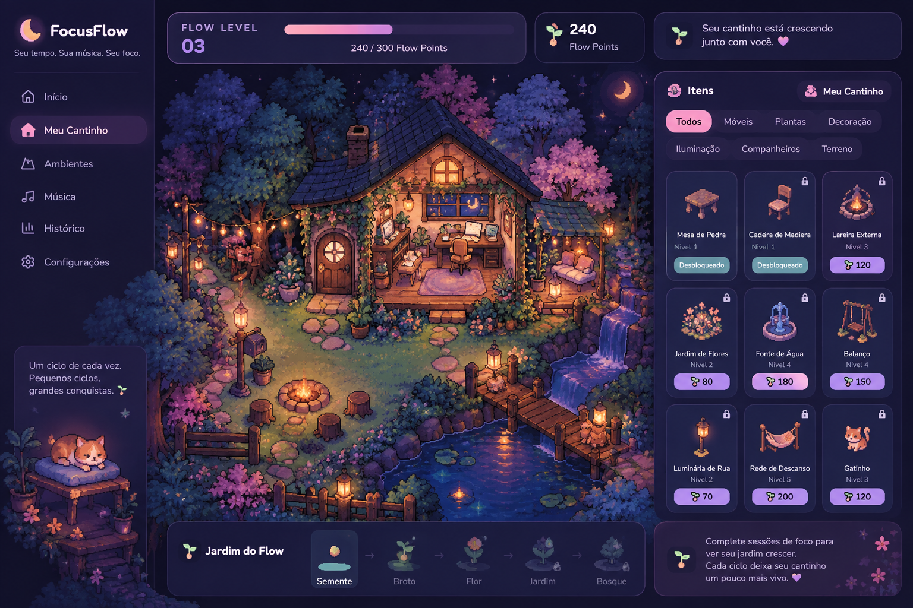
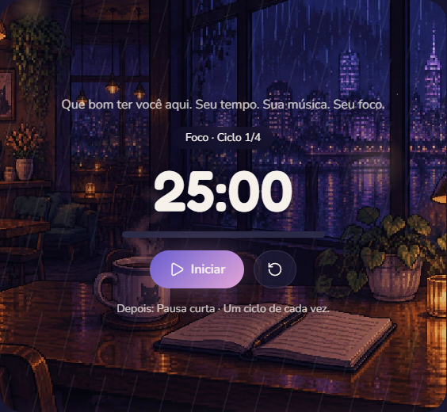

Arte conceitual do Meu Cantinho — referência visual para o protótipo em desenvolvimento.

# 🌙 FocusFlow

### Seu tempo. Sua música. Seu foco.

**Um ciclo de cada vez. Um cantinho de cada vez.**

Uma experiência de produtividade que combina Pomodoro, personalização em pixel art e a atmosfera acolhedora dos cozy games.

🚧 Protótipo em desenvolvimento · ainda não publicado

🎧 Atmosfera lo-fi · 🌿 Pequenas conquistas · ☕ Foco e descanso

---

## 🍃 Sobre o projeto

O **FocusFlow** é um projeto acadêmico de aplicação web voltada à organização de momentos de concentração e descanso. A proposta é transformar sessões de estudo ou trabalho em uma experiência visual acolhedora, na qual o progresso também ajuda a construir um espaço personalizado.

A ideia nasceu da vontade de estudar com mais estrutura e tornar o início de uma sessão mais convidativo. O projeto valoriza pequenos avanços, pausas e personalização, com uma experiência inspirada em **cozy games, pixel art e lo-fi**.

## 🖼️ Timer no protótipo

  
   
  Captura do protótipo em desenvolvimento: timer Pomodoro com ambiente lo-fi.

## 🎯 O problema

Organizar a rotina de estudos envolve mais do que iniciar um cronômetro. Entre os desafios que motivaram o projeto estão:

- Começar e sustentar períodos de concentração.
- Lembrar de descansar entre as sessões.
- Encontrar ferramentas agradáveis e personalizáveis.
- Perceber o próprio progresso ao longo do tempo.

O FocusFlow propõe reunir **gestão do tempo, ambiente e motivação** em uma mesma experiência.

## ✨ A experiência FocusFlow

| Elemento | Proposta |
| --- | --- |
| ⏱️ Pomodoro | Alternar períodos de foco e pausas. |
| 🌙 Ambiente cozy | Criar uma atmosfera visual acolhedora para estudar ou trabalhar. |
| 🏡 Meu Cantinho | Personalizar um cenário com itens e decoração em pixel art. |
| 🌱 Progressão | Dar significado às sessões concluídas por meio de conquistas. |
| 🎧 Música | Complementar o ambiente; integrações musicais completas estão previstas na evolução do produto. |

### ⏱️ Foco e pausas

O fluxo apresentado no projeto utiliza **25 minutos de foco**, **5 minutos de pausa curta** e **15 minutos de pausa longa após quatro ciclos**. A personalização dos tempos faz parte dos próximos passos.

### 🏡 Meu Cantinho

O “Meu Cantinho” é o centro da proposta de personalização: um pequeno mundo que acompanha a jornada de foco.

O protótipo demonstra um cenário cozy, catálogo de itens e recursos de decoração com posicionamento e rotação. A evolução inclui ampliar o catálogo e refinar a experiência em diferentes tamanhos de tela.

### 🌱 Gamificação sem pressão

O projeto distingue dois tipos de progresso:

| Recurso | Papel na experiência |
| --- | --- |
| **Flow XP** | Experiência acumulada para evolução de nível. |
| **Flow Points** | Moeda para adquirir itens de personalização. |
| **Jardim do Flow** | Progressão visual: Semente → Broto → Flor → Jardim → Bosque. |

A regra de design é que **comprar itens consome pontos, sem reduzir o XP**. A proposta também preserva conquistas durante períodos de inatividade, respeitando o ritmo de cada pessoa.

Esses elementos descrevem a proposta de gamificação do projeto; os detalhes podem mudar durante a evolução do protótipo.

## 🧭 Jornada de uso

1. **Prepare o ambiente:** explore o cenário e as opções disponíveis.
2. **Inicie o foco:** escolha uma tarefa e comece uma sessão Pomodoro.
3. **Faça uma pausa:** acompanhe a alternância entre concentração e descanso.
4. **Acompanhe o progresso:** explore os elementos de evolução apresentados no protótipo.
5. **Personalize seu cantinho:** organize a decoração conforme suas preferências.

## 🛠️ Tecnologia e estágio atual

O projeto está em **fase de protótipo funcional**, desenvolvido com apoio do **Lovable**. A documentação acadêmica registra interface e funcionalidades locais, além de telas do mundo, catálogo de itens e experiência mobile.

| Tecnologia | Papel | Situação documentada |
| --- | --- | --- |
| **Lovable** | Construção da interface e do protótipo. | Em uso. |
| **Supabase** | Contas, banco de dados e sincronização de progresso. | Planejado; integração ainda não conectada na versão apresentada. |
| **n8n** | Automações e notificações. | Planejado. |
| **APIs de música** | Ampliação da experiência musical. | Planejado. |
| **IA** | Sugestões personalizadas. | Planejado. |

### O que já é demonstrado

- Timer Pomodoro funcional.
- Interface com identidade visual cozy.
- Personalização do “Meu Cantinho”.
- Catálogo de itens e recursos de posicionamento e rotação.
- Versão mobile em refinamento.

A sincronização entre dispositivos ainda depende da futura integração com a nuvem. Os recursos de histórico e indicadores de sessões também fazem parte da evolução prevista.

## 🗺️ Próximos passos

- [ ] Refinar responsividade e usabilidade em dispositivos móveis.
- [ ] Permitir personalização dos tempos de foco e pausa.
- [ ] Implementar contas e sincronização de progresso com Supabase.
- [ ] Construir histórico e indicadores de sessões reais.
- [ ] Ampliar itens, cenários e opções de personalização.
- [ ] Integrar música e sons ambientes.
- [ ] Explorar notificações e automações com n8n.
- [ ] Avaliar sugestões personalizadas com IA.

## 🚧 Disponibilidade

O FocusFlow está em fase de protótipo e **ainda não foi publicado**. Este README apresenta a proposta, o estágio documentado e os próximos passos do projeto.

As funcionalidades podem evoluir durante o desenvolvimento. O link de demonstração e as instruções de instalação serão adicionados quando o projeto estiver pronto para ser compartilhado.

## 📚 Aprendizados

O desenvolvimento do FocusFlow conecta definição de problema, concepção de produto, prototipação e experiência do usuário. O projeto também exercita decisões sobre gamificação, apresentação visual e planejamento de futuras integrações.

## 💜 Autoria

Projeto desenvolvido por **Isadora**, estudante de Ciência da Computação, com interesse em dados, tecnologia e experiências digitais úteis e acolhedoras.

---

**Cuide do seu foco. Construa seu espaço.** 🌿

FocusFlow · Um pequeno mundo de conquistas.

<!--
README baseado na apresentação acadêmica do FocusFlow.
Endereço informado para uso futuro: https://lo-fi-study-scape.lovable.app
Ative o link público somente quando decidir disponibilizar o protótipo.
Atualize o estágio das funcionalidades conforme a aplicação evoluir.
Envie README.md e a pasta assets juntos para a raiz do repositório.
A capa usa assets/focusflow-meu-cantinho.png. Preserve esse caminho.
A imagem é arte conceitual; não é uma captura da aplicação pronta.
Adicione screenshots reais e a licença do projeto quando estiverem definidos.
-->
