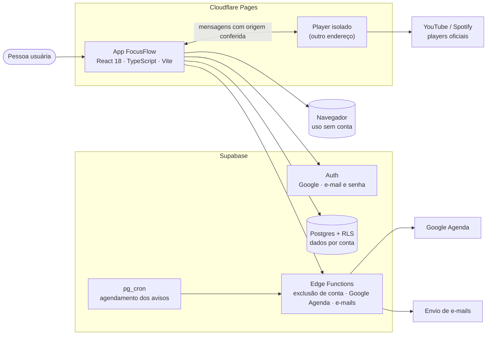

# Arquitetura do FocusFlow

O FocusFlow é publicado em **dois sites separados** no Cloudflare Pages: o app e o player de música. O app guarda os dados no navegador ou, com conta, no Supabase. O player fica isolado em outro endereço para que os scripts do YouTube e do Spotify não tenham acesso aos dados do app.

## Componentes

| Componente | Responsabilidade |
| --- | --- |
| App (React 18, TypeScript, Vite) | Interface, Pomodoro, tarefas, sugestões por regras locais, histórico, Jardim do Flow e exportação `.ics`. |
| Player isolado | Toca YouTube e Spotify em outro endereço. Conversa com o app só por mensagens, com a origem conferida. |
| Navegador | Guarda os dados de quem usa o app sem conta. |
| Supabase Auth | Login com Google e com e-mail e senha. |
| Supabase Postgres + RLS | Perfis e dados sincronizados. Cada conta só acessa os próprios dados (testado com duas contas). |
| Supabase Edge Functions | Operações no servidor: exclusão de conta, Google Agenda e avisos por e-mail. |
| pg_cron | Agenda os avisos por e-mail dentro do próprio Supabase. |

## Segurança

- Content Security Policy rígida.
- Nenhuma chave secreta no código do app: o build é interrompido se encontrar uma.
- Apenas a chave pública (anon) do Supabase no cliente.
- Player de terceiros isolado do app.
- Regras de acesso do banco testadas com duas contas temporárias.

## Testes

| Tipo | Ferramenta | Observação |
| --- | --- | --- |
| Unitários | Vitest | Regras do app (jardim, sessões, tarefas, fuso, `.ics`). |
| Navegador | Playwright (Chromium) | Fluxos principais. Parte das integrações (Google, Gmail, Supabase) ainda roda com serviços simulados. |
| Manual | Navegador real | Computador, tablet e celular. Ver a seção "O que já foi testado de verdade" no README. |
